# 젠지표류기 — 현정현 (조장 · 서비스 기획)

> 회사라는 낯선 섬에 표류한 신입사원이 **배우고 · 묻고 · 연습하고 · 실천하며** 오늘도 무사히 퇴근하도록 돕는 인터랙티브 회사생활 가이드

[서비스 바로가기 ↗](https://genz-project-one.vercel.app) · [팀 저장소 (전체 코드) ↗](https://github.com/genz-pyoryugi/genz-project)


| 기간 | 팀 | 내 역할 | 과정 |
|---|---|---|---|
| 2026.09.28 – 11.09 | 4명 | **조장** · 서비스 기획 · AI 기능 기획 · UX 설계 | 동아일보 부트캠프 [미디어 프론티어] 생성형 AI 마스터 클래스 |

이 저장소는 팀 프로젝트에서 **제가 맡은 기획 · 설계 작업**과 **서비스 기능**을 정리한 문서예요. 코드 전체는 팀 저장소에 있어요.

---

## 목차

1. [기획 배경](#1-기획-배경)
2. [내가 한 일](#2-내가-한-일)
3. [핵심 기능](#3-핵심-기능)
4. [AI 팀장 시뮬레이션](#4-ai-팀장-시뮬레이션)
5. [작동 구조](#5-작동-구조)
6. [데이터베이스 설계](#6-데이터베이스-설계)
7. [기술 스택 · 의사결정](#7-기술-스택--의사결정)
8. [피드백 반영](#8-피드백-반영)
9. [사용자 테스트 결과](#9-사용자-테스트-결과)
10. [팀 구성 · 일정](#10-팀-구성--일정)
11. [프로젝트 구조](#11-프로젝트-구조)

---

## 1. 기획 배경

| | |
|---|---|
| **문제** | 질문 타이밍, 근태 규정, 회의 예절처럼 “다들 아는 것”을 신입은 혼자 찾아야 해요. 물어보기도 애매하고, 틀리면 첫인상이 흔들려요. |
| **대상** | 첫 출근을 앞둔, 또는 입사 1개월 이내의 신입사원 |
| **접근** | One Source Multi Use — 동아일보 기사와 공식 자료(표준취업규칙 · 가이드북 PDF) 하나를 카드뉴스 · 퀴즈 · 라디오 · 체크리스트로 다시 만들었어요. |
| **목표** | 읽고 끝나는 가이드가 아니라, **직접 답하고 피드백받는 연습형 가이드** |
| **전환점** | 10/08 멘토 피드백 — 커뮤니티를 ‘고민상담소’로 바꾸고, 사무실을 클릭해 탐험하는 UX로 전면 개편 |

**7개 주제** — 조직 이해·적응 · 업무 절차·기준 · 질문·소통 · 협업·동료 존중 · 직장 관계·예절 · 근무·재택 수칙 · 공용 공간·비품

---

## 2. 내가 한 일

조장으로 서비스 방향을 정하고, 기능 우선순위와 팀 일정을 조율했어요.

- **서비스 방향 · 핵심 기능 기획** — 배우기 → 묻기 → 연습하기 → 실천하기 4단계 학습 구조
- **7개 주제 콘텐츠 구조 설계** — 기사 · 공식 PDF 한 소스를 여러 기능으로 재구성
- **UX 설계** — 메뉴 대신 책상 위 물건 8개를 눌러 탐험하는 메인 사무실, 인트로 · 퇴근길 흐름
- **AI 팀장 시뮬레이션 설계** — 상황 21개 × 팀장 성격, 평가 기준 3가지(15점 만점)
- **측정 설계** — 학습 앞뒤에 측정 장치를 넣어 “도움이 됐는지” 확인할 수 있게 함
- **피드백 4회 반영 · 협업 리딩** — 받은 피드백을 다음 단계의 출발점으로 정리

### 이용 흐름 (User Flow) · 측정 장치

| 단계 | 내용 | 측정 장치 |
|---|---|---|
| 1. 사무실 입장 · 주제 고르기 | 걱정되는 주제를 먼저 고르고 학습 순서를 안내받아요 | 직장 경험 질문 |
| 2. 카드뉴스로 배우기 | 주제별 5장 카드로 핵심 행동을 익혀요 | 학습 전후 자기평가 |
| 3. 퀴즈로 확인하기 | 상황별 문제와 해설 · 틀린 문제 다시 풀기 | 첫 정답률 |
| 4. AI 팀장과 연습하기 | 실제 상황에서 직접 답하고 피드백받아요 | 평가 기준 3가지 |
| 5. 고민 남기기 · 듣기 | 고민상담소 포스트잇 · 보이는 라디오 | |
| 6. 실천하기 · 근태 확인 | 체크리스트 · 근태 가이드 · 책상 메모 | |
| 7. 퇴근 · 성장 기록 | 오늘 연습한 것과 다음에 연습할 것 하나 | |

<p>
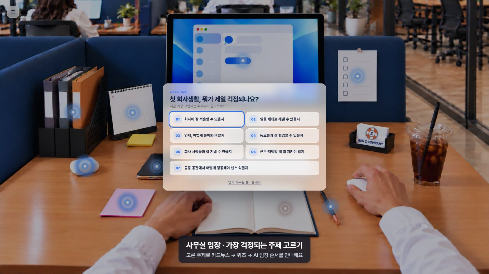

</p>

---

## 3. 핵심 기능

메인 사무실의 **책상 위 물건 8개가 곧 기능**이에요. 사무실 투어가 고른 주제로 카드뉴스 → 퀴즈 → AI 팀장 순서를 안내해요.


| 단계 | 기능 | 화면 |
|---|---|---|
| 📖 배우기 | **카드뉴스** — 7개 주제 카드 + 학습 전후 자기평가 | 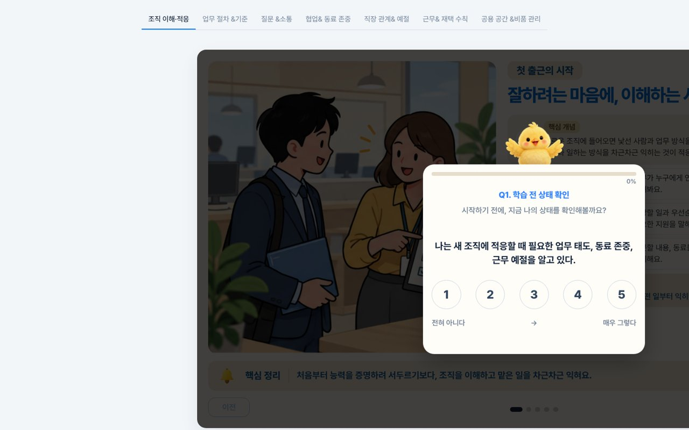 |
| 📖 배우기 | **퀴즈** — 주제별 문제 · 해설 · 틀린 문제 다시 풀기 | 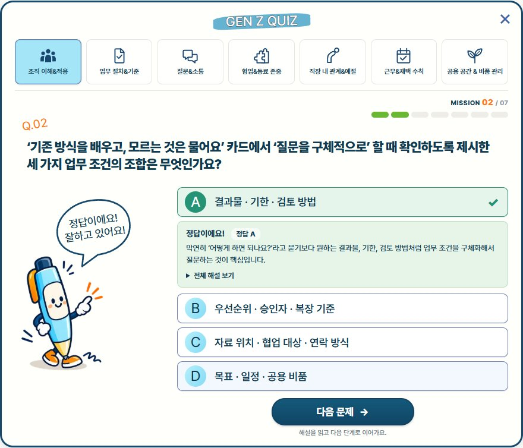 |
| 💬 묻기 | **고민상담소** — 포스트잇 고민 · 선배 테이프 조언 | 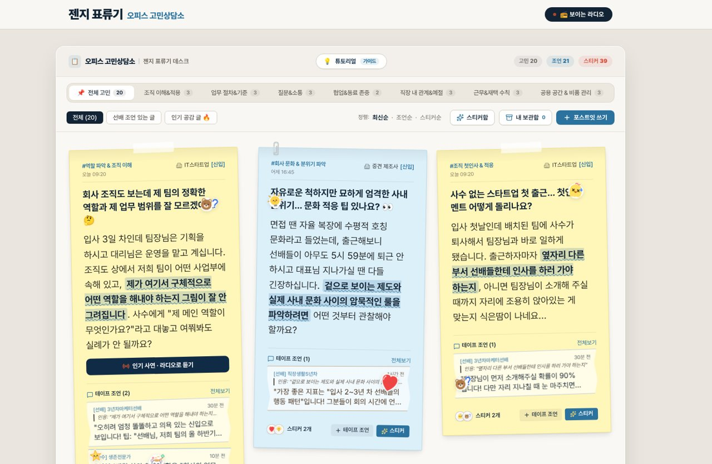 |
| 💬 묻기 | **보이는 라디오** — 인기 사연을 선배 · 신입 DJ 대화로 | 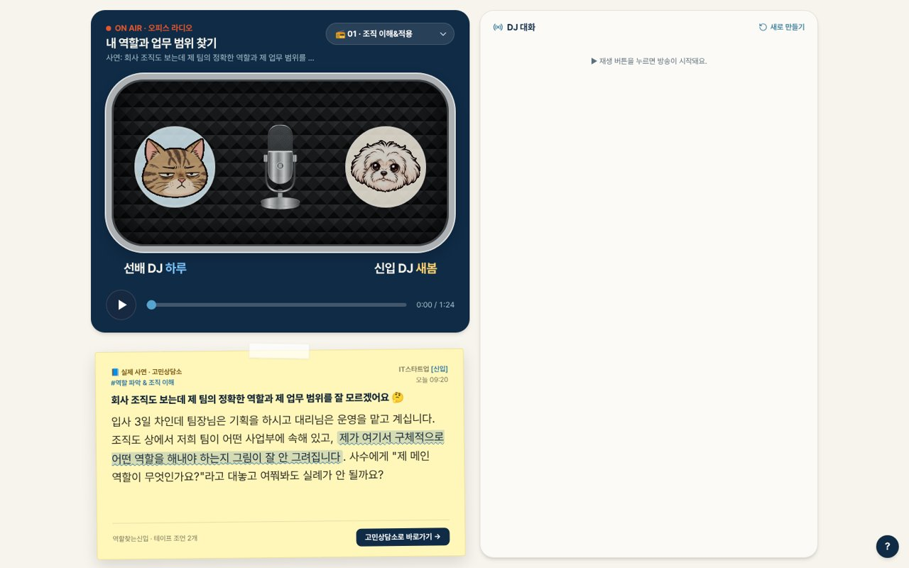 |
| 💬 묻기 | **SOS 상담** — 급한 순간 AI에게 바로 질문 | 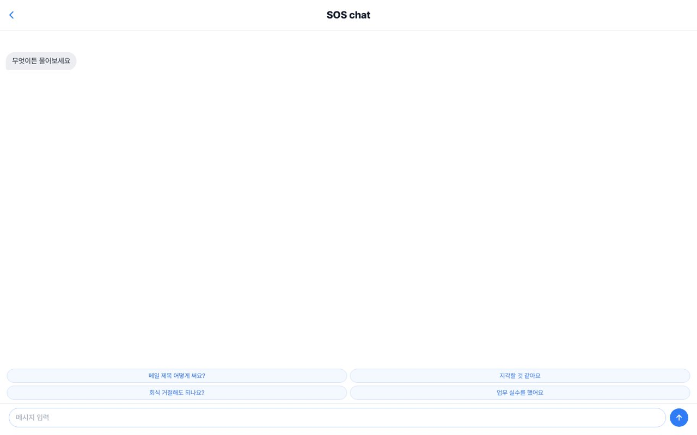 |
| 🎯 연습하기 | **AI 팀장 시뮬레이션** — 팀장과 대화하고 15점 만점 피드백 | 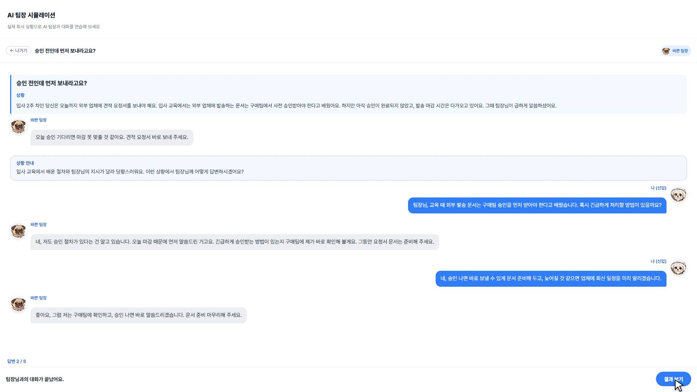 |
| ✅ 실천하기 | **체크리스트** — 실천 미션 · 근거 PDF · 책상 메모 | 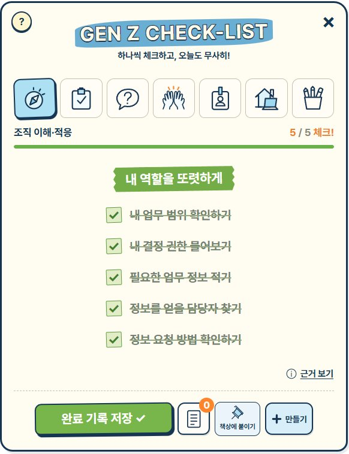 |
| ✅ 실천하기 | **근태 가이드** — 취업규칙 스티커 · OX 퀴즈 | 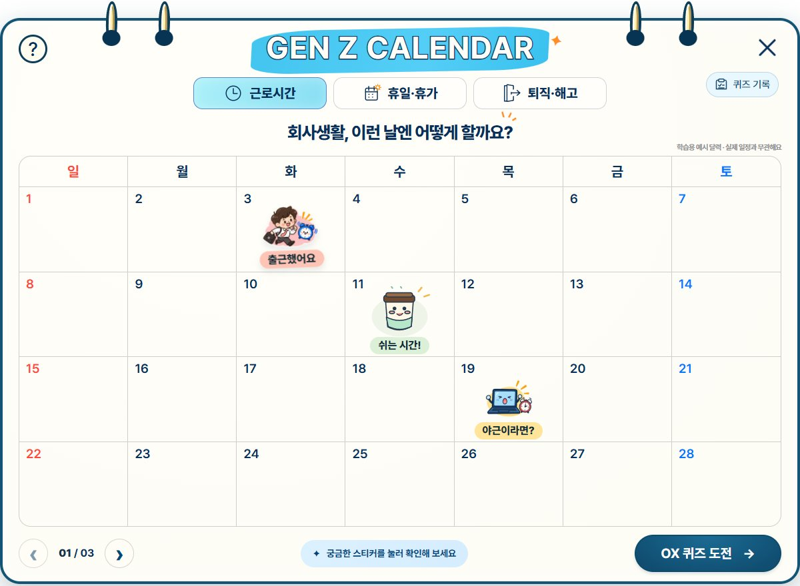 |
| 🌙 퇴근 | **오늘의 성장 기록** — 오늘 연습한 것 · 점수와 AI 피드백 · 다음에 연습할 것 하나 | 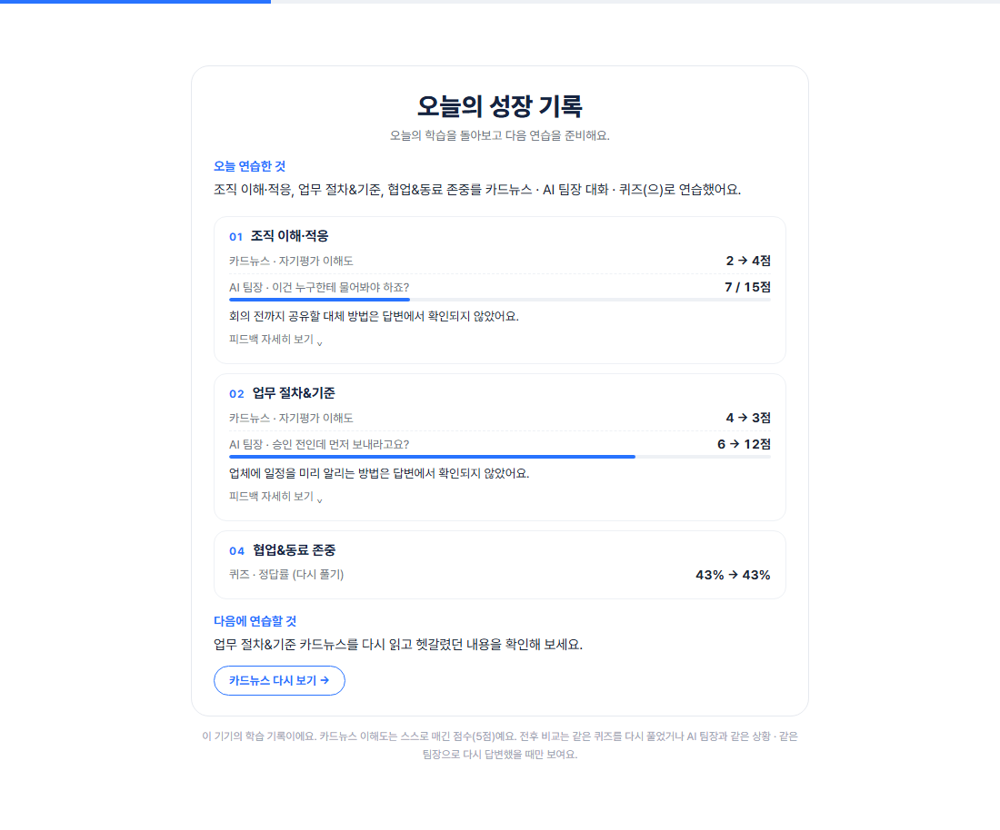 |

### 학습 기능 · 기록

- **Supabase 데이터 연동** — 퀴즈 · 체크리스트 · 달력 문항과 해설을 DB에서 불러오고, 항목마다 근거 PDF 페이지 연결
- **내 기록은 나만** — 익명 세션 + RLS, OX 퀴즈 점수는 DB 함수가 서버에서 채점
- **학습 추적** — 퀴즈 이어 풀기 · 문항 버전 관리 · 카드뉴스 학습 전후 자기평가
- **학습 → 연습 연결** — 퀴즈에서 틀린 개념과 이어진 AI 팀장 상황에 ‘추천’ 표시

### 안전한 커뮤니티 — 거르는 장치 세 겹

| 1. 입력 검사 | 2. 개인정보 탐지 | 3. 신고 |
|---|---|---|
| 필수 · 길이 · 도배, 외부 링크 · 욕설 단어 | 전화 · 이메일 · 주민 · 계좌 → 자동 가리기 제안 | 내가 신고하면 바로 가림, 3건 이상이면 라디오 사연에서 제외 |

라디오 방송 흐름: 고민상담소 인기 사연 → Gemini 대본 생성 → TTS 선배 · 신입 DJ → 보이는 라디오(대사 싱크)

---

## 4. AI 팀장 시뮬레이션

**상황 21개 × 팀장 성격 4종(+직접 설정).** 신입이 실제로 고민하는 장면에서 팀장에게 직접 답하고, **상황 파악 · 대응 방식 · 후속 행동** 세 기준으로 15점 만점 피드백을 받아요.

<p>
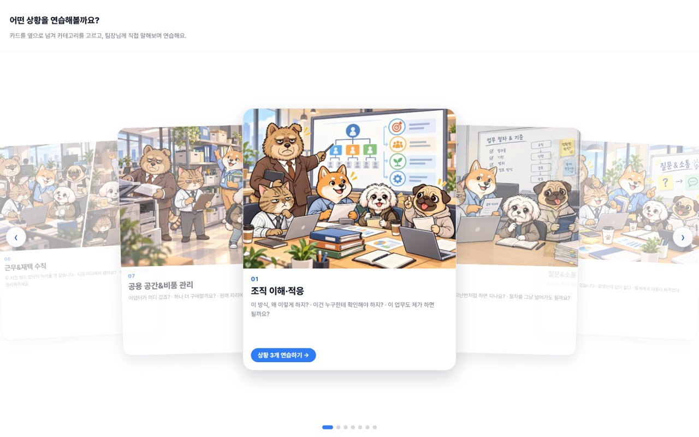

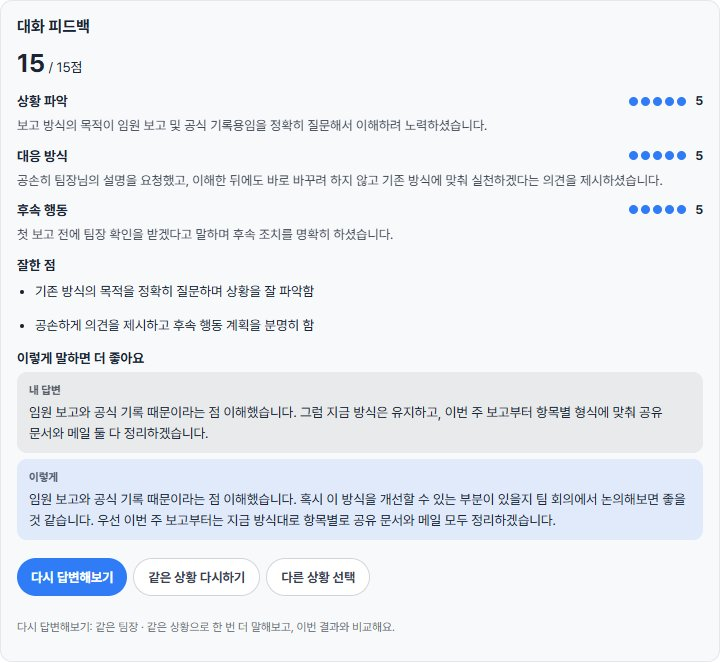
</p>

① 주제 · 상황 고르기 → ② 팀장과 대화 → ③ 15점 만점 피드백 · 다시 답변해보기


### 프롬프트 설계 — 무엇을, 어떻게 나눴나

| 1. 시나리오 데이터 | 2. 공통 대화 규칙 | 3. 팀장 성격 | 4. 평가 · 안전 |
|---|---|---|---|
| 공개 상황 · 첫 대사 | 앞선 지시와 일관되게 | 차분한 · 꼼꼼한 | 점수별 기준 1~5 |
| 팀장만 아는 고정 사실 | 질문 의도에 직접 답 | 바쁜 · 직설적인 | 근거 먼저 · temperature 0 |
| 사용자 대응별 반응 | 판단 떠넘기지 않기 | 직접 설정 | 없는 행동 단정 금지 |
| 상황별 평가 규칙 | 목표 달성 시 종료 | **말투만 바뀌고 사실은 고정** | 위기 신호 → 상담처 안내 |
| `scenarios.ts` | `route.ts` | `personalities.ts` | `route.ts` · `safety.ts` |

프롬프트를 코드와 데이터로 나눠 Git으로 버전 관리해요. 새 상황은 시나리오 데이터 한 덩어리만 추가하면 되고, 모의 AI 테스트로 규칙이 깨지지 않았는지 매번 확인해요.

### 프롬프트 개선 과정 — 테스트 → 원인 → 수정

| 문제 | 원인 · 수정 |
|---|---|
| 팀장이 먼저 말할 이유가 없는 상황(“읽었는데 답이 없다”)에서도 먼저 말을 걺 | **사용자 대응형**으로 변경 — 상황 안내를 먼저 보여 주고 사용자가 먼저 행동. 혼자 기다리거나 처리하면 미리 정해 둔 장면으로 이어지게 함 |
| “먼저 보내 주세요”라고 해 놓고, 질문을 받으면 “원래 승인이 필요해요”만 반복 | 원인은 “된다/안 된다를 먼저 말한다” 규칙과 시나리오 기준의 충돌. 답하기 전에 **질문 의도와 지금까지 한 지시를 먼저 정리**(JSON Schema)하고, 지시를 바꿀 땐 자기 말을 인정하며 정정하게 함 |
| 묻지 않은 정보를 먼저 말하고, 반말이 섞임 | 같은 대화를 모델별로 비교 → 작은 모델이 규칙을 자주 어김. 비용(1회 약 $0.05) 확인 후 **gpt-4.1로 전환**, 반말이 감지되면 한 번 다시 생성 |
| 도움말이 아직 묻지 않은 항목(“마감도 확인해 보세요”)을 짚어 정답을 흘림 | 도움말을 **고정 사실을 모르는 별도 호출**로 분리. 팀장의 질문만 보고 “무엇을 말하면 될지” 방향만 알려 줌 |
| “네, 알겠습니다”만 해도 높은 점수, 같은 답도 점수가 흔들림 | 점수별 기준 · 근거를 먼저 쓰고 점수, temperature 0, 아주 짧은 답 상한. 같은 답을 3번 평가해도 같은 점수(15 · 15 · 15 / 5 · 5 · 5) 확인 |

> 예시 — 나: “아까는 먼저 보내라고 하셨잖아요?”
> 팀장: “맞아요, 아까는 급해서 먼저 보내자고 했는데, 승인 여부는 아직 확인이 안 돼서요. 구매팀에 바로 연락할 테니 발송은 잠깐만 보류해 주세요.”

### AI 팀장 핵심 흐름

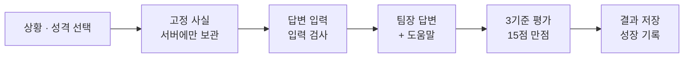

---

## 5. 작동 구조

사용자의 클릭과 답변이 화면 → 서버 · AI → 데이터 저장을 거쳐 피드백과 학습 기록으로 돌아와요. **AI 키는 서버에만 두고, 브라우저는 서버를 거쳐서만 AI와 DB에 닿아요.**

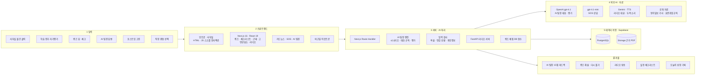

**보안 · 인증** — 익명 세션 · RLS(본인만) · 서버 env 키 · HMAC 대화 토큰

---

## 6. 데이터베이스 설계

로그인 없이 쓰는 대신 **익명 사용자 한 명에 모든 학습 기록이 1:N**으로 이어져요. 이름 · 이메일 같은 개인정보는 저장하지 않고, 익명 ID로 퀴즈 · 자기평가 · AI 연습 · 직장 경험을 연결해 경험별로 분석해요.

- `auth.users` — 익명 세션 사용자 (회원가입 없음)
- RLS로 본인 기록만 읽기 · 쓰기, 쓰기는 검증 함수(`lt_ingest`)만 통과
- AI 프롬프트 · 근거 PDF · 브라우저 기록은 DB 테이블과 분리

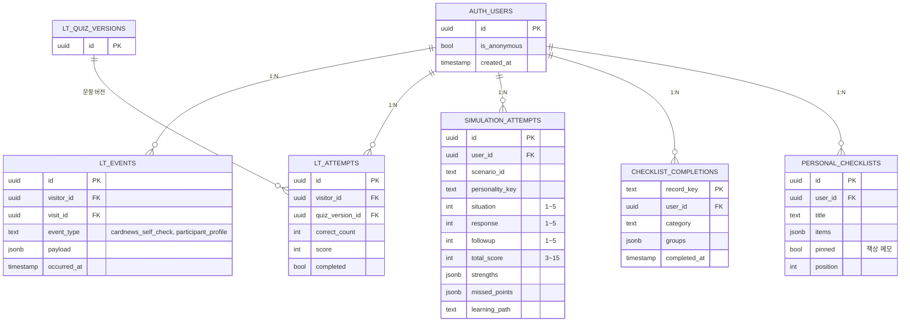

| 구분 | 내용 |
|---|---|
| **콘텐츠 테이블** (관리자가 올리는 학습 자료) | `quizzes` 문항 · 해설 · `lt_quiz_versions` 문항 버전 · `checklists` 미션 · 근거 URL · `calendar_quiz_questions` OX 퀴즈 · `contents` · `categories` 카드뉴스 · 주제 |
| **관리자용 뷰** | `simulation_by_experience` · `simulation_path_compare` · `lt_cardnews_self_check_summary` |
| **DB 밖 저장소** | Supabase Storage 근거 PDF · 시나리오 · 프롬프트는 코드로 버전 관리(`scenarios.ts`) · 브라우저 localStorage 성장 기록 · 진행 상태 · 미전송 기록 |
| **외부 API** | OpenAI · Gemini · Gemini TTS |

---

## 7. 기술 스택 · 의사결정

| 영역 | 기술 |
|---|---|
| **Frontend** | Next.js 16.3 (App Router) · React 19.2 · TypeScript 5 · Tailwind CSS 4 · HTML · JS(인트로 · 사무실 · 카드뉴스) |
| **Backend API** | Route Handler(simulation · sos · radio 등 11개) · FastAPI 라디오 대본 서버 · Uvicorn · Python · HMAC 토큰 |
| **AI · Data** | OpenAI gpt-4.1 · gpt-4.1-mini · Gemini(라디오 대본) · TTS · JSON Schema 구조화 응답 · 공개 자료(동아일보 · 표준취업규칙) |
| **Infra · Security** | Supabase PostgreSQL · Auth · Storage · RLS · 익명 세션 · Vercel 배포 · node:test(PGlite · 모의 AI 테스트) |

| 고민 | 선택 | 이유 |
|---|---|---|
| 누구나 사용 | 로그인 페이지를 만들지 않음 | 회사 내부 · 공공기관 배포 시 누구나 바로 쓰도록 |
| 개인 기록 | Supabase 익명 세션 + RLS | 로그인 없이도 사람마다 기록 분리 |
| AI 키 보호 | Route Handler에서만 AI 호출 | 키를 서버에만 두고 브라우저 노출 차단 |
| 점수 조작 | DB 함수에서 채점 | 브라우저는 답만 보내고 정답 비교는 서버가 |
| AI 대화 상태 | 서명된 세션 토큰(HMAC) | DB 없이도 같은 상황 · 팀장 성격을 끝까지 고정 |
| 민감한 고백 | 역할극 중단 + 상담처 안내 | 연습 중이라도 실제 피해 · 위기 신호를 먼저 돌봄 |

---

## 8. 피드백 반영

피드백 4회(1차 9/29 · 외부 교육 담당자 · 2차 10/13 · 3차 10/20)와 멘토 의견을 기능으로 바꿨어요.

| 시점 | 받은 피드백 | 반영 |
|---|---|---|
| 1차 · 9/29 동아일보 | 가상의 회사를 설정하고 공개 데이터로 시나리오 구성 | 가상 회사 젠지컴퍼니 · 동아일보 기사 · 표준취업규칙 · 가이드북 PDF로 콘텐츠 구성 |
| 1차 · 9/29 | 프롬프트를 왜 · 어떻게 만들었는지, 보관 · 재사용 방법 | 프롬프트를 시나리오 데이터 · 대화 규칙 · 성격 · 평가로 나눠 코드로 버전 관리 |
| 1차 · 9/29 | 블라인드 같은 커뮤니티 · 보이는 라디오 옆 소통 공간 | 고민상담소 + 보이는 라디오 서로 바로가기 · 인기 사연을 라디오로 |
| 외부 교육 담당자 | 타깃 · 페르소나 구체화 | 대상을 입사 1개월 이내 신입으로 · 시나리오를 신입 입장으로 다시 씀 · 첫 화면에서 직장 경험 수집 |
| 외부 교육 담당자 | 포스트잇 형태의 ‘고민 상담실’ · 고민 → 해결 방법을 얻어 가는 경험 | 고민 남기기 → 선배 조언 · 라디오로 듣기 → AI 팀장으로 연습 → 퇴근길에 다음 연습 추천 |
| 2차 · 10/13 동아일보 | “어디서부터 익혀야 할지 모르겠다” · 햄버거 메뉴 · 순서형 튜토리얼 | 첫 화면에서 걱정되는 주제 고르기 → 카드뉴스 → 퀴즈 → AI 팀장 투어 · 왼쪽 슬라이딩 메뉴 |
| 2차 · 10/13 | 사연 입력 유효성 체크 | 입력 검증 · 개인정보 가리기 · AI 표현 검사 · 신고 |
| 2차 · 10/13 | 강아지 · 고양이가 실제로 말하는 시연 | 보이는 라디오 DJ 캐릭터가 대사에 맞춰 말함 |
| 3차 · 10/20 학원 Z세대 사용자 | 내가 쓴 글만 모아보기 · 해시태그 고정 오류 | 내 보관함 · 태그가 고른 주제를 따라가도록 수정 |
| 3차 · 10/20 | 퀴즈 진행 저장 · 나만의 체크리스트 | 다른 화면에 다녀와도 이어 풀기 · 직접 항목 추가 + 책상에 붙이기 |
| 멘토 | AI 팀장에서 민감한 상황 대응 | 실제 괴롭힘 · 위기 신호면 역할극을 멈추고 상담처 안내 |

> “첫 출근 날 내 PC에 이런 프로그램이 깔려 있다면 든든할 것 같다.” — 학원 Z세대 사용자

---

## 9. 사용자 테스트 결과

2026.10.28 · 배포 사이트 · 46개 브라우저 참여 · 참여자는 취업 준비생 중심. 익명 학습 기록(Supabase)에서 집계했고, **규모가 작아 참고 수준으로 해석**했어요.

| 측정 | 결과 | 해석 |
|---|---|---|
| ① 틀린 문제 다시 풀기 (조직 이해·적응) | 처음 응시 5회 **42.9%** → 다시 풀기 4회 **70.8%** | 해설을 본 뒤 오답만 다시 푼 결과라, 이해도가 올랐다고 단정하기는 어려워요 |
| ② 자기평가 vs 실제 정답률 | 학습 전 “알고 있다” **4.11/5** (9명) vs 퀴즈 첫 정답률 **42.9%** | 서로 다른 응답자일 수 있어 참고용. 읽기만 하는 가이드가 아니라 연습형 구조가 필요한 이유로 해석 |
| ③ AI 팀장 평가 (5개 상황 · 19번 연습) | 상황 파악 **3.0** · 대응 방식 **2.9** · 후속 행동 **2.7** (5점 만점) | 5개 상황 중 4개에서 ‘후속 행동’이 가장 낮음. 테스트 도중 평가 기준을 더 엄격하게 바꿈 |

### 한계와 다음 단계

- **실제 대상을 만나지 못했어요** — 입사 1개월 이내 참여자 0명, 직장 경험을 고른 12명 중 9명이 취업 전 → 실제 신입사원 대상 테스트가 필요해요.
- **참여 규모가 작아요** — 46은 사람이 아닌 브라우저 수, 직장 경험 질문은 테스트 도중 추가 → 같은 사람의 학습 전후를 비교할 수 있게 다시 측정해요.
- **순서 안내를 끝까지 따른 경우는 1/19** — 2차 피드백으로 넣은 학습 순서 안내를 끝까지 따른 경우가 적었어요 → 안내 방식을 다시 볼 부분이에요.
- **아직 반영하지 않은 피드백** — 사내 자료를 찾아 답하는 RAG 연동 · 부서별 맞춤 콘텐츠는 다음 단계로 남겨 두었어요.
- **참여자 구분 기반은 마련했어요** — 직장 경험별로 학습 기록을 나눠 볼 수 있어 다음 테스트부터 경험별 비교가 가능해요.

---

## 10. 팀 구성 · 일정

| 역할 | 담당 |
|---|---|
| **현정현 · 조장** | 서비스 기획 · AI 기능 기획 · UX 설계 — 서비스 방향 · 핵심 기능 기획, 7개 카테고리 콘텐츠 구조 설계, AI 팀장 시뮬레이션 설계, 기능 우선순위 조율 · 협업 리딩 |
| 팀원 · 백엔드 · 데이터 | 퀴즈 · 체크리스트 · 근태 가이드, SOS 상담 API · 학습 기록, Supabase · 서버 API · RLS |
| 팀원 · 커뮤니티 · 라디오 | 고민상담소, 입력 유효성 검사 · 신고, 보이는 라디오(AI 대본 · 음성) |
| 팀원 · 콘텐츠 | 카드뉴스 제작, 기사 · 공식 PDF 조사, 학습 전후 체크 → 퀴즈 흐름 설계 |

| 기간 | 단계 | 내용 |
|---|---|---|
| 9.28 ~ 9.30 | 01 문제 정의 | 7개 주제 분류 · 기사 · 공식 PDF 조사 · 1차 피드백(9/29) |
| 10.1 ~ 10.9 | 02 화면 구축 | Next.js 기반 구성 · 인트로 · 카드뉴스 · 퀴즈 · 멘토 피드백 → 고민상담소 |
| 10.12 ~ 10.16 | 03 사무실 통합 | 오브제 8개 연결 · 안내 투어 · SOS API · 보이는 라디오 · 2차 피드백(10/13) |
| 10.20 ~ 10.22 | 04 AI 팀장 고도화 | 사용자 피드백 반영(10/20) · 시뮬레이션 개편 · 입력 검사 · 민감 상황 응답 |
| 10.26 ~ 10.28 | 05 배포 · 테스트 | Vercel 배포 · 신입 관점 시나리오 · gpt-4.1 · 사용자 테스트 · 성장 기록 |
| 10.29 ~ 11.9 | 06 정리 · 발표 | 시연 영상 · 결과 분석 · 포트폴리오 · 발표 |

---

## 11. 프로젝트 구조

```
genz-project/
├── src/
│   ├── app/
│   │   ├── api/
│   │   │   ├── simulation/   AI 팀장 시작 · 대화 · 평가 (OpenAI, 서명 토큰)
│   │   │   ├── sos/          SOS 상담 · 대화 저장
│   │   │   ├── radio/        라디오 대본 · 음성 (Gemini)
│   │   │   ├── quizzes/      퀴즈 문항 · 해설
│   │   │   ├── checklists/   체크리스트 미션 · 근거
│   │   │   ├── community/    포스트잇 · 조언 · 신고
│   │   │   └── learning/     학습 기록 조회
│   │   ├── quiz/ checklist/ calendar/    퀴즈 · 체크리스트 · 근태 화면
│   │   └── community/ visible-radio/     고민상담소 · 보이는 라디오
│   └── lib/
│       ├── simulation/       scenarios · personalities · safety · results
│       ├── community/        validation · report
│       └── moderation.ts     사이트 공통 욕설 검사
├── public/
│   ├── intro/                인트로 · 사무실 (스크롤 인터랙션 · 투어 · 직장 경험)
│   ├── web/                  카드뉴스 · SOS · AI 팀장 화면
│   ├── outro/                퇴근길 · 오늘의 성장 기록
│   └── tracking/             학습 기록 수집 (오프라인 보관 · 재전송)
├── radio-server/             FastAPI 라디오 서버 (프롬프트 · 스키마)
├── supabase/migrations/      테이블 · RLS · 검증 함수 · 관리자 뷰
└── tests/                    모의 AI · RLS · 채점 · 저장 테스트
```

---

젠지표류기 · 동아일보 부트캠프 [미디어 프론티어] 생성형 AI 마스터 클래스 2026 · 사용자 테스트 수치는 2026.10.28 익명 학습 기록(개발 중 확인 실행 제외)
