# 젠지표류기 — 현정현 (조장 · 서비스 기획)

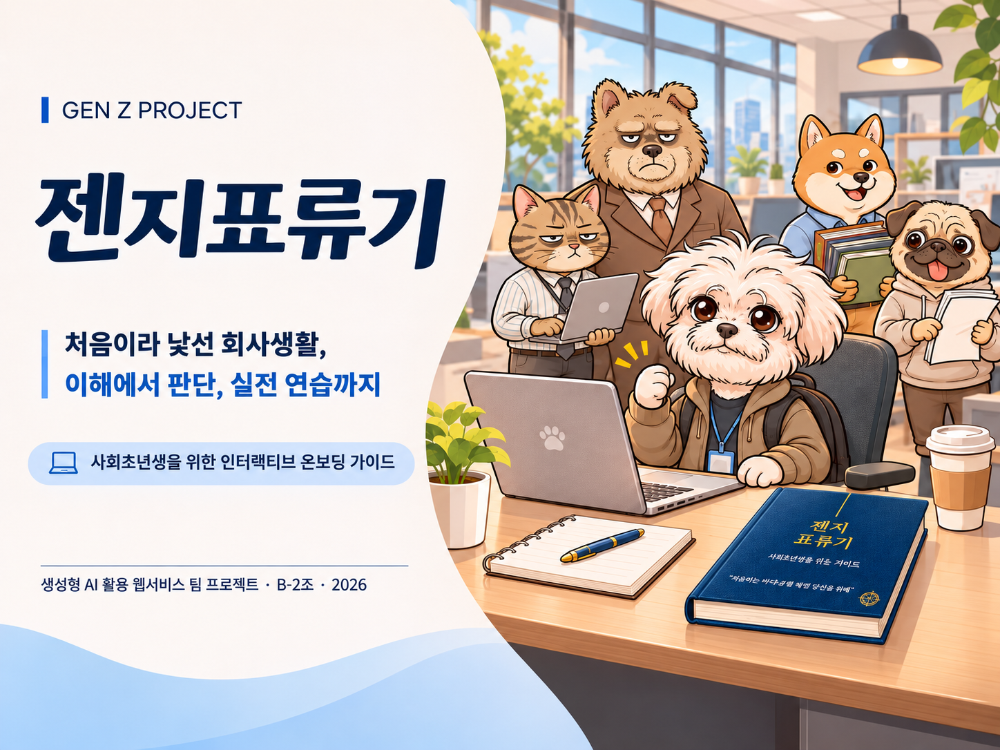

> 낯선 회사에 표류한 신입사원이 **배우고 · 연습하며** 무사히 퇴근하도록 돕는 회사생활 가이드

<table>
  <tr><th align="left" width="130">기간</th><td>2026.09.28 – 11.09</td></tr>
  <tr><th align="left">팀</th><td>4명 · 팀 프로젝트</td></tr>
  <tr><th align="left">내 역할</th><td><b>조장</b> · 서비스 기획 · AI 기능 기획 · UX 설계</td></tr>
  <tr><th align="left">과정</th><td>동아일보 부트캠프 [미디어 프론티어] 생성형 AI 마스터 클래스</td></tr>
  <tr><th align="left">기술</th><td>Next.js · React · TypeScript · Supabase · OpenAI API · Gemini · Vercel</td></tr>
  <tr><th align="left">링크</th><td><a href="https://genz-project-one.vercel.app">서비스 바로가기 ↗</a> · <a href="https://github.com/genz-pyoryugi/genz-project">팀 저장소 (전체 코드) ↗</a></td></tr>
</table>

---

## 목차

<table>
  <tr><th align="left" width="90">기획</th><td><a href="#s1">1. 기획 및 비전</a> — 문제 정의 · 개발 타임라인</td></tr>
  <tr><th align="left">기능</th><td><a href="#s2">2. 핵심 기능 (튜토리얼 → 카드뉴스 → 퀴즈 → AI 팀장)</a> · <a href="#s3">3. AI 팀장 시뮬레이션</a> · <a href="#s4">4. 학습 기능 · 성장 기록</a></td></tr>
  <tr><th align="left">설계</th><td><a href="#s5">5. 서비스 설계</a> · <a href="#s6">6. 작동 구조</a> · <a href="#s7">7. 데이터베이스(ERD)</a></td></tr>
  <tr><th align="left">개발</th><td><a href="#s8">8. 기술 스택 · 의사결정</a> · <a href="#s9">9. 프로젝트 구조</a></td></tr>
  <tr><th align="left">검증</th><td><a href="#s10">10. 피드백 반영</a> · <a href="#s11">11. 사용자 테스트 결과</a></td></tr>
  <tr><th align="left">팀</th><td><a href="#s12">12. 팀 구성</a></td></tr>
</table>

---

출발점 기사: [동아일보 「신입사원 첫 출근, ‘이 실수’했다간 첫 단추 잘못 끼운다」 (2026.04.10) ↗](https://www.donga.com/news/Society/article/all/20260410/133715092/2)

---

## 2. 핵심 기능

**튜토리얼 → 학습 → 이해 → 실전 연습**

<table>
  <tr>
    <td width="50%" valign="top">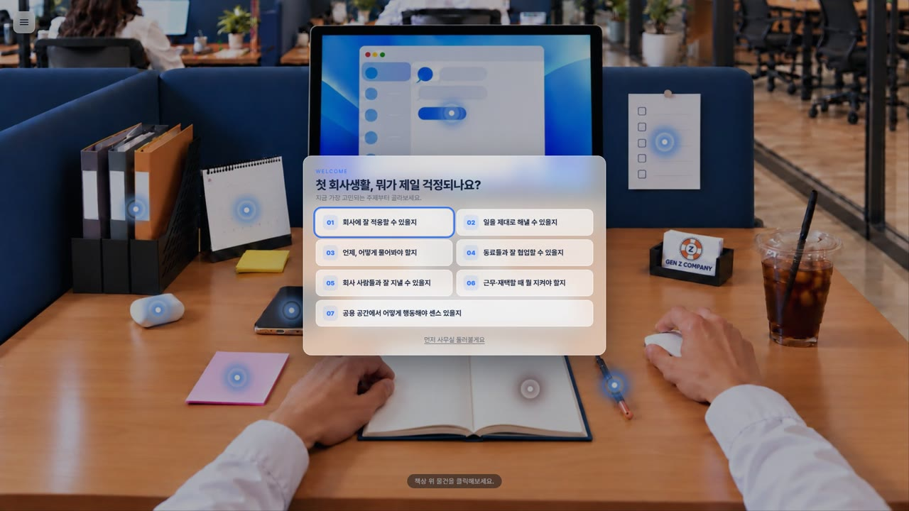 <b>0 · 튜토리얼</b> 걱정되는 주제를 고르면 카드뉴스 → 퀴즈 → AI 팀장 순서로 안내</td>
    <td width="50%" valign="top">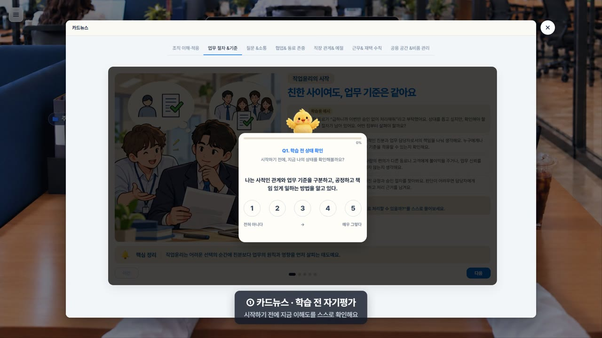 <b>1 · 카드뉴스 · 학습 전후 체크</b> 읽기 전과 후에 이해도를 스스로 체크해 변화 확인</td>
  </tr>
  <tr>
    <td width="50%" valign="top">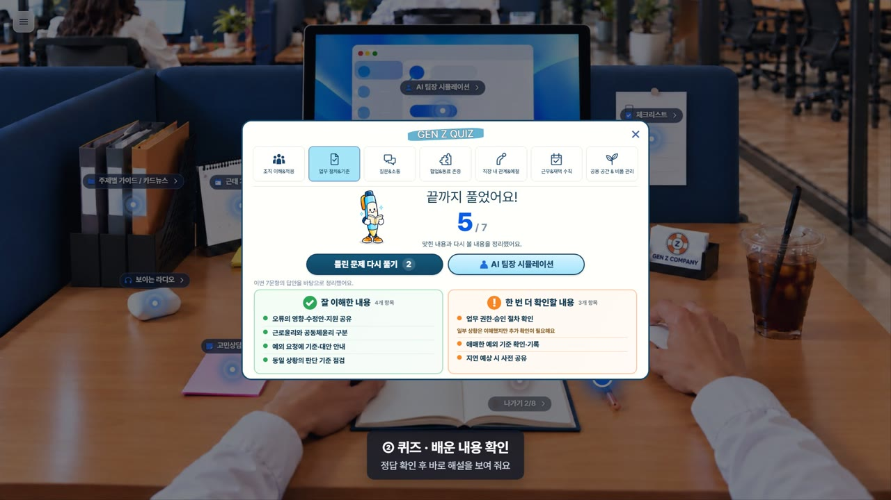 <b>2 · 퀴즈 · 오답 다시 풀기</b> 상황별 문제와 해설, 틀린 문제만 골라 다시 풀기</td>
    <td width="50%" valign="top">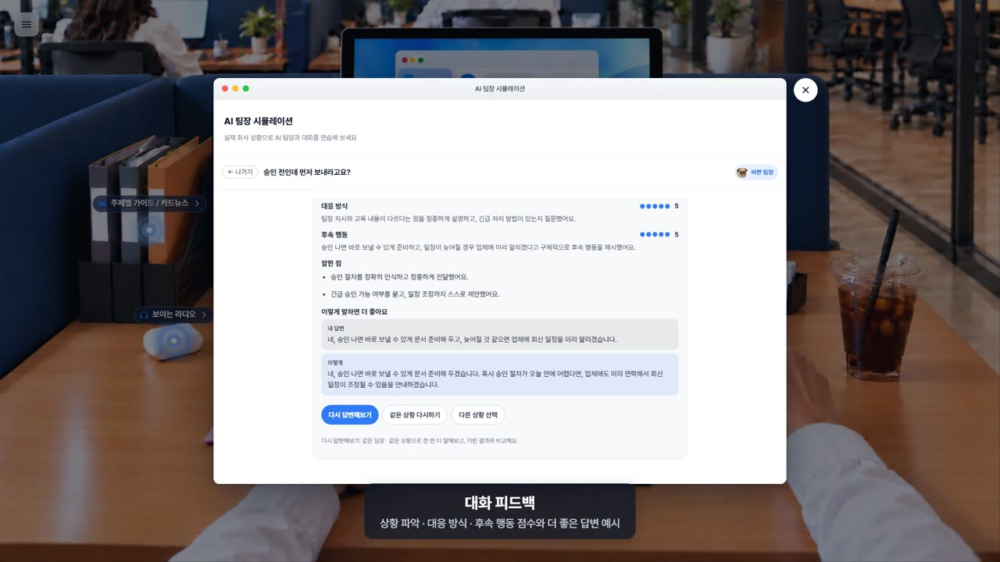 <b>3 · AI 팀장 피드백</b> 팀장에게 직접 답하고 3가지 기준 · 15점 만점 피드백</td>
  </tr>
</table>

**부가 콘텐츠** — 같은 주제를 다양하게

<table>
  <tr>
    <td width="20%" valign="top">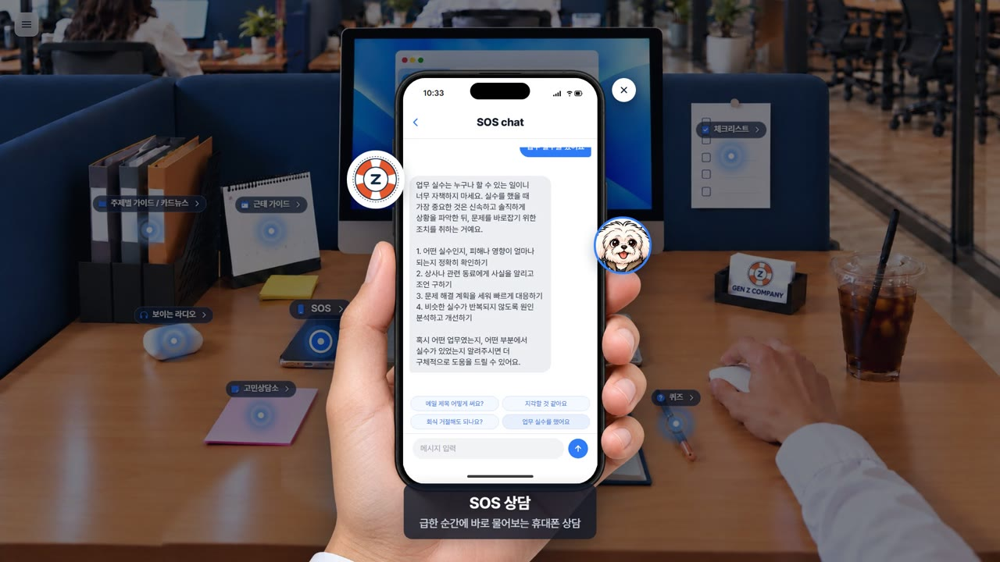 <b>SOS 상담</b></td>
    <td width="20%" valign="top">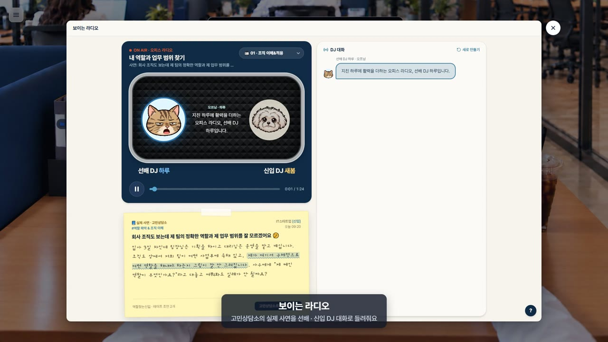 <b>보이는 라디오</b></td>
    <td width="20%" valign="top">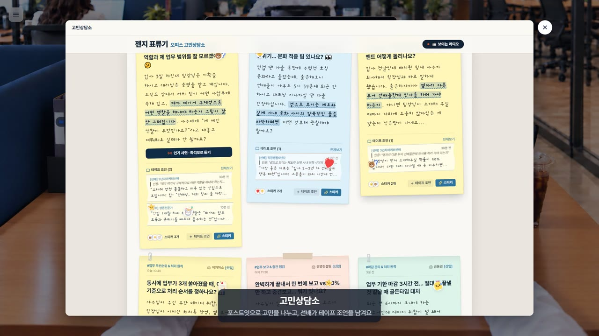 <b>고민상담소</b></td>
    <td width="20%" valign="top">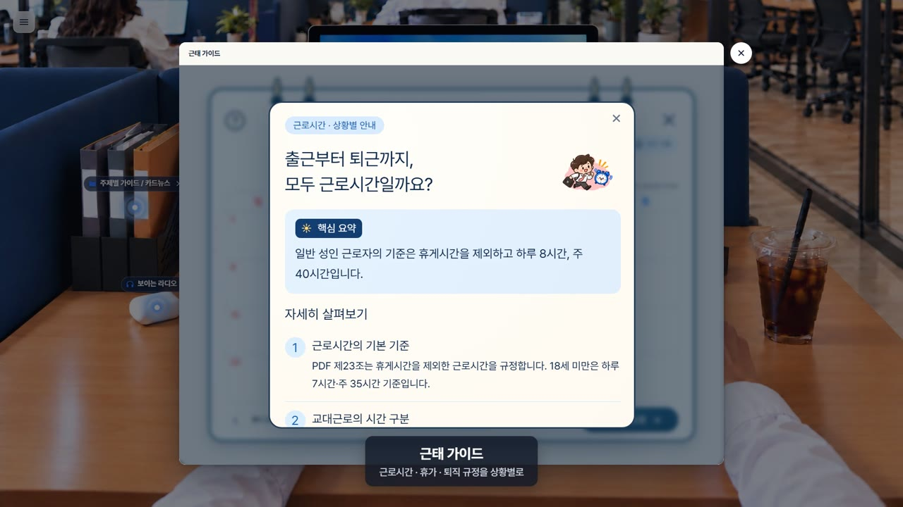 <b>근태 가이드</b></td>
    <td width="20%" valign="top">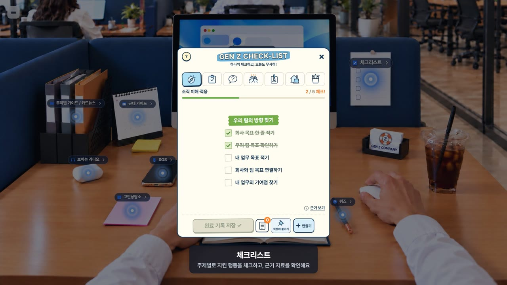 <b>체크리스트</b></td>
  </tr>
</table>

---

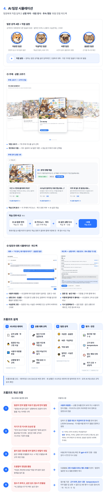

---

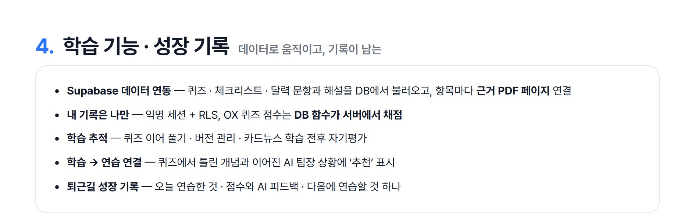

**퇴근길 아웃트로** — 사무실을 나서면 인사 → 스크롤하면 오늘의 성장 기록

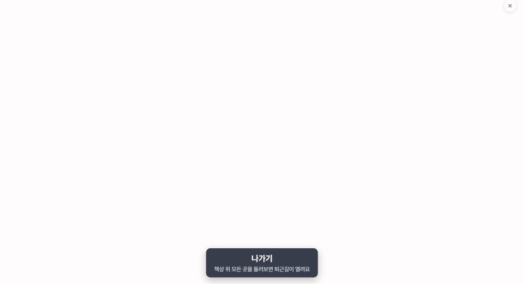

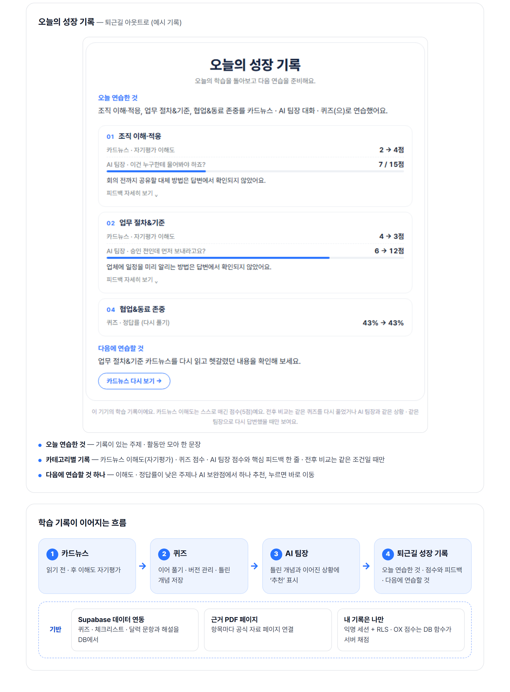

---

---

---

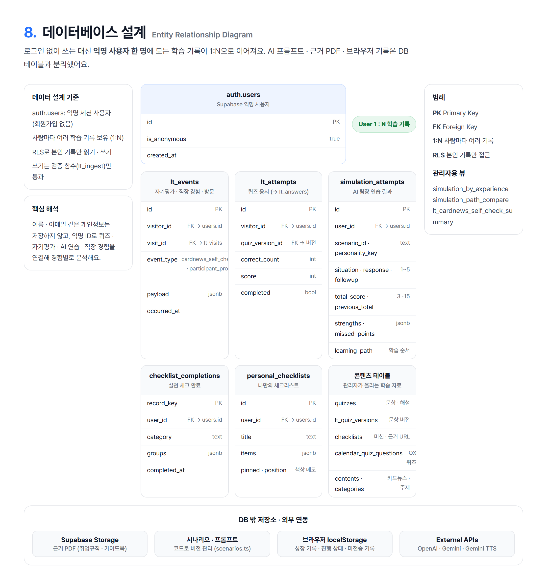

---

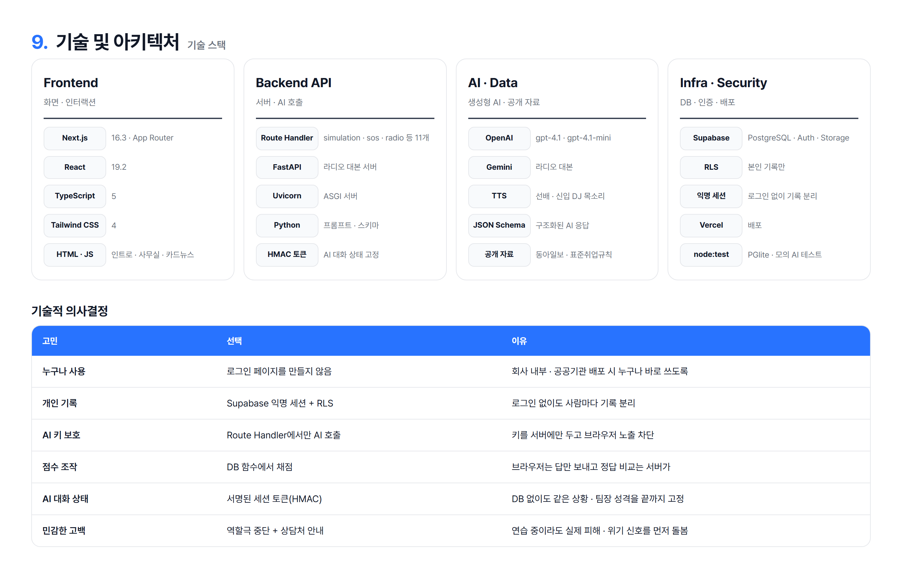

---

---

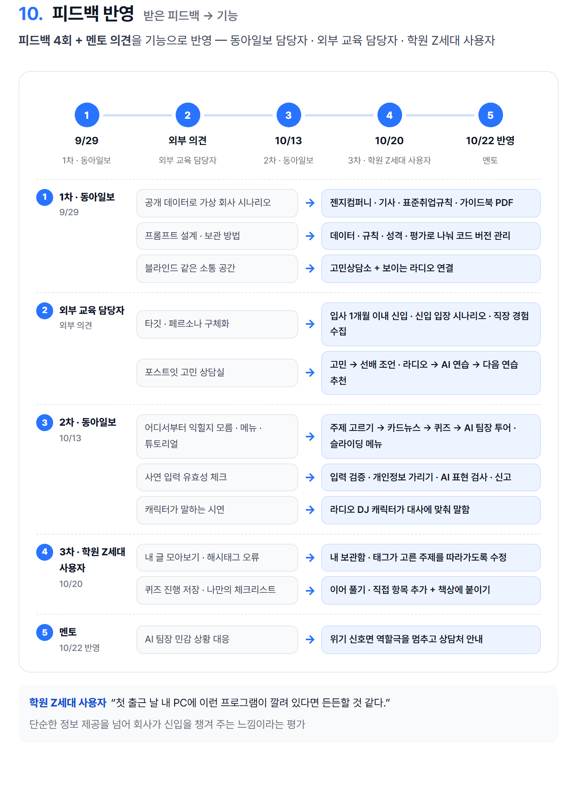

---

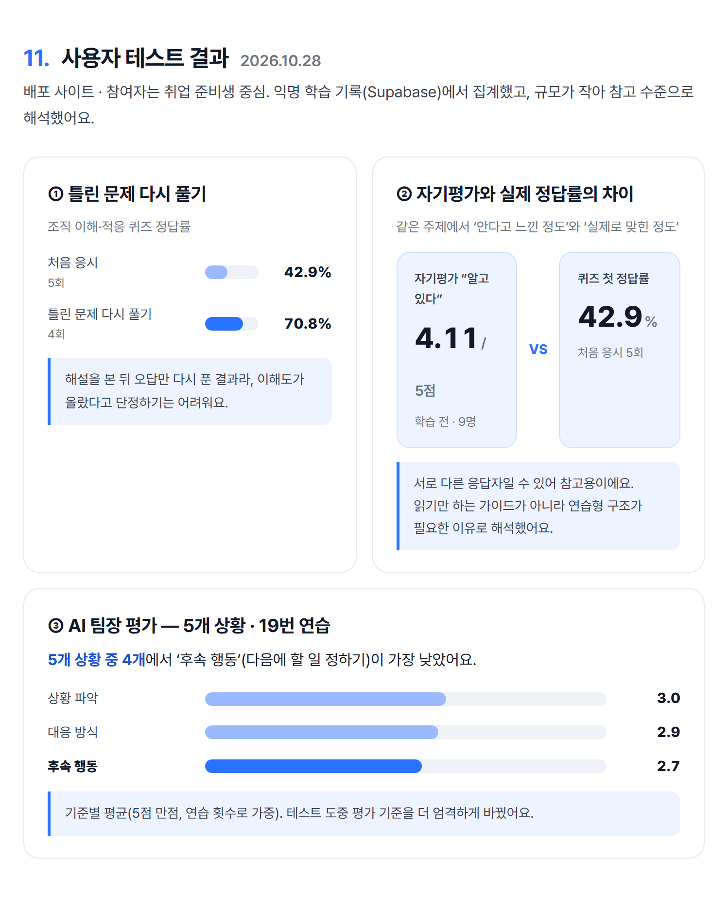

---

## 12. 팀 구성

| 역할 | 담당 |
|---|---|
| **현정현 · 조장** | 서비스 기획 · AI 기능 기획 · UX 설계 — 서비스 방향 · 핵심 기능 기획, 7개 카테고리 콘텐츠 구조 설계, AI 팀장 시뮬레이션 설계, 기능 우선순위 조율 · 협업 리딩 |
| 팀원 · 백엔드 · 데이터 | 퀴즈 · 체크리스트 · 근태 가이드, SOS 상담 API · 학습 기록, Supabase · 서버 API · RLS |
| 팀원 · 커뮤니티 · 라디오 | 고민상담소, 입력 유효성 검사 · 신고, 보이는 라디오(AI 대본 · 음성) |
| 팀원 · 콘텐츠 | 카드뉴스 제작, 기사 · 공식 PDF 조사, 학습 전후 체크 → 퀴즈 흐름 설계 |

---

젠지표류기 · 동아일보 부트캠프 [미디어 프론티어] 생성형 AI 마스터 클래스 2026 · 사용자 테스트 수치는 2026.10.28 익명 학습 기록(개발 중 확인 실행 제외)
