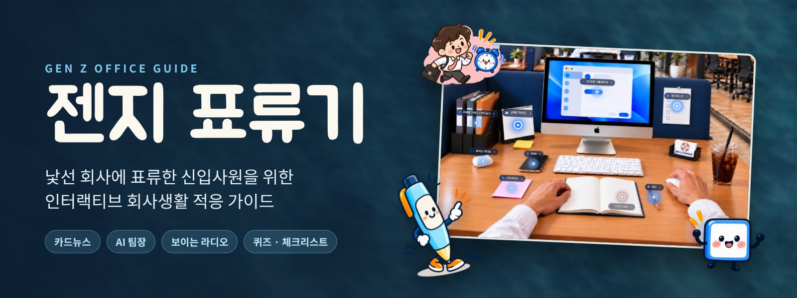
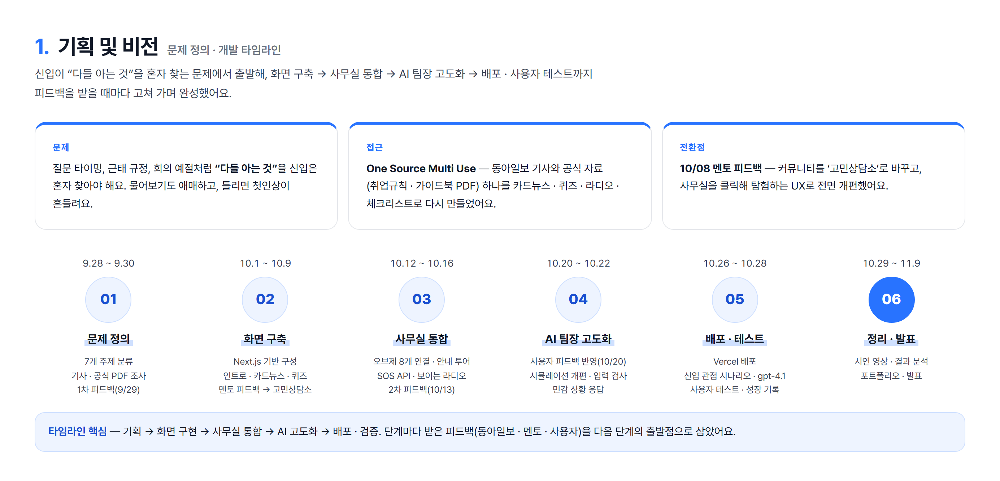
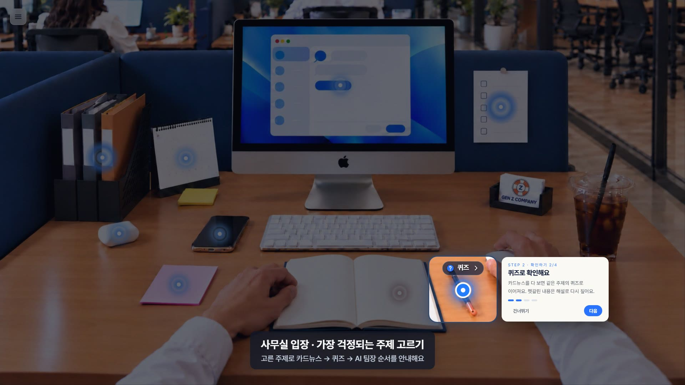
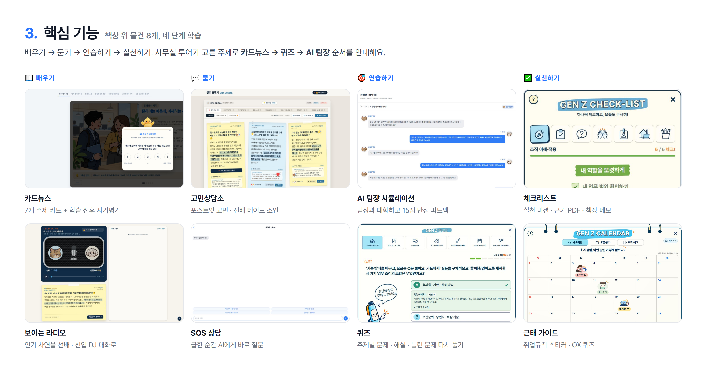
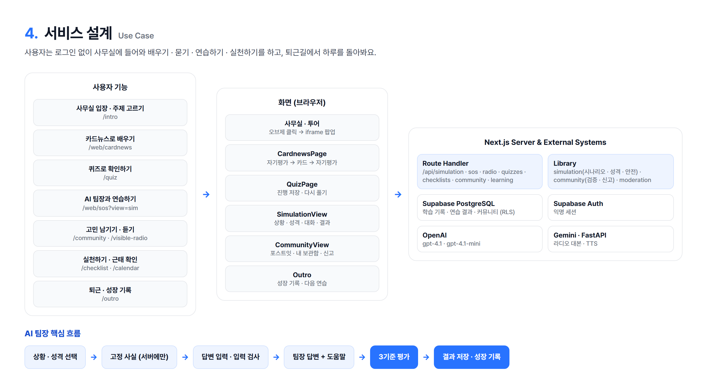
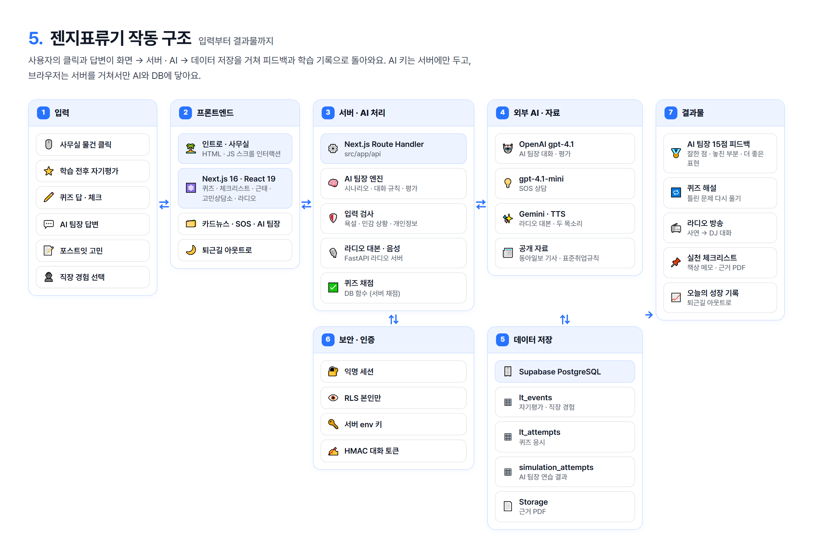
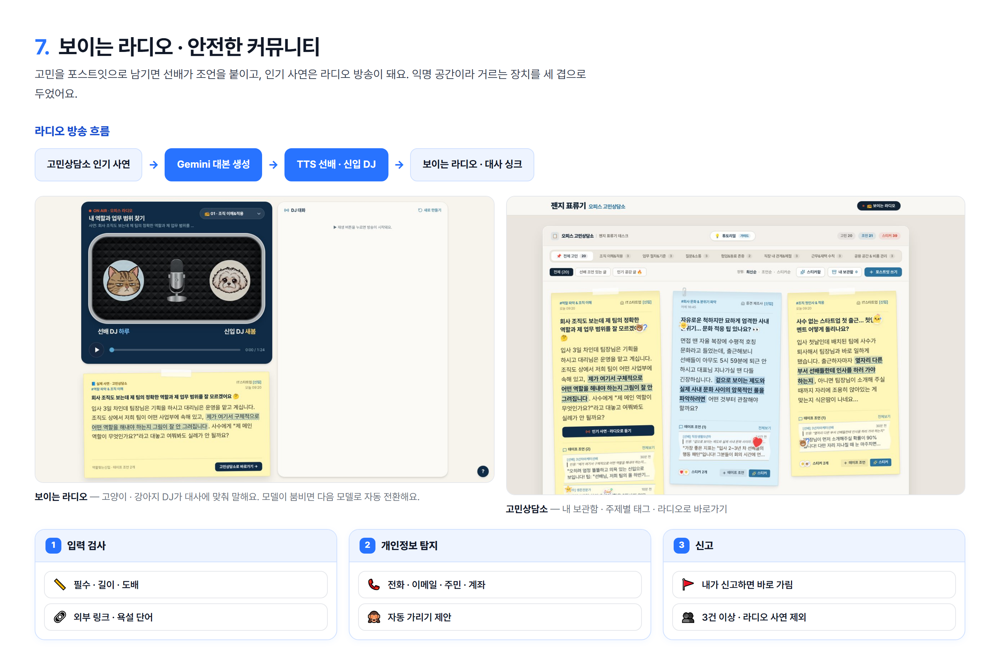
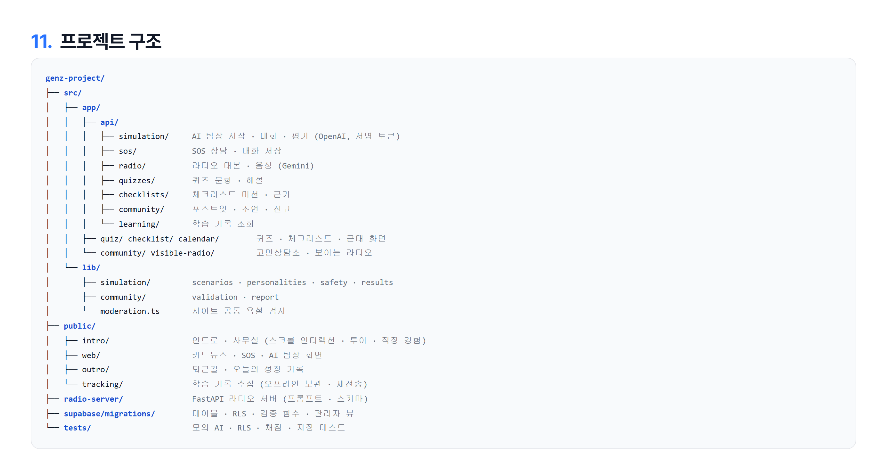

# 젠지표류기 — 현정현 (조장 · 서비스 기획)

> 회사라는 낯선 섬에 표류한 신입사원이 **배우고 · 묻고 · 연습하고 · 실천하며** 오늘도 무사히 퇴근하도록 돕는 인터랙티브 회사생활 가이드

<table>
  <tr><th align="left" width="130">기간</th><td>2026.09.28 – 11.09</td></tr>
  <tr><th align="left">팀</th><td>4명 · 팀 프로젝트</td></tr>
  <tr><th align="left">내 역할</th><td><b>조장</b> · 서비스 기획 · AI 기능 기획 · UX 설계</td></tr>
  <tr><th align="left">과정</th><td>동아일보 부트캠프 [미디어 프론티어] 생성형 AI 마스터 클래스</td></tr>
  <tr><th align="left">기술</th><td>Next.js · React · TypeScript · Supabase · OpenAI API · Gemini · Vercel</td></tr>
  <tr><th align="left">링크</th><td><a href="https://genz-project-one.vercel.app">서비스 바로가기 ↗</a> · <a href="https://github.com/genz-pyoryugi/genz-project">팀 저장소 (전체 코드) ↗</a></td></tr>
</table>

---

## 목차

1. [기획 및 비전](#s1)
2. [내가 한 일](#s2)
3. [핵심 기능](#s3)
4. [서비스 설계](#s4)
5. [작동 구조](#s5)
6. [AI 팀장 시뮬레이션](#s6)
7. [보이는 라디오 · 안전한 커뮤니티](#s7)
8. [학습 기능 · 성장 기록](#s8)
9. [데이터베이스 설계](#s9)
10. [기술 스택 · 의사결정](#s10)
11. [프로젝트 구조](#s11)
12. [피드백 반영](#s12)
13. [사용자 테스트 결과](#s13)
14. [팀 구성](#s14)

---

---

## 2. 내가 한 일

조장으로 서비스 방향을 정하고, 기능 우선순위와 팀 일정을 조율했어요.

| 맡은 일 | 내용 |
|---|---|
| **서비스 방향 · 핵심 기능 기획** | 배우기 → 묻기 → 연습하기 → 실천하기 4단계 학습 구조 |
| **콘텐츠 구조 설계** | 7개 주제 — 기사 · 공식 PDF 한 소스를 카드뉴스 · 퀴즈 · 라디오 · 체크리스트로 재구성 |
| **UX 설계** | 메뉴 대신 책상 위 물건 8개를 눌러 탐험하는 메인 사무실, 인트로 · 퇴근길 흐름 |
| **AI 팀장 시뮬레이션 설계** | 상황 21개 × 팀장 성격, 평가 기준 3가지(15점 만점) |
| **측정 설계** | 학습 앞뒤에 측정 장치를 넣어 “도움이 됐는지” 확인 — 자기평가 → 카드뉴스 → 퀴즈 → AI 팀장 → 평가 기준 3가지 |
| **피드백 반영 · 협업 리딩** | 피드백 4회를 다음 단계의 출발점으로 정리, 기능 우선순위 조율 |

첫 화면에서 걱정되는 주제를 고르면, 카드뉴스 → 퀴즈 → AI 팀장 순서로 안내해요.

---

---

---

---

---

---

---

---

---

---

---

---

## 14. 팀 구성

| 역할 | 담당 |
|---|---|
| **현정현 · 조장** | 서비스 기획 · AI 기능 기획 · UX 설계 — 서비스 방향 · 핵심 기능 기획, 7개 카테고리 콘텐츠 구조 설계, AI 팀장 시뮬레이션 설계, 기능 우선순위 조율 · 협업 리딩 |
| 팀원 · 백엔드 · 데이터 | 퀴즈 · 체크리스트 · 근태 가이드, SOS 상담 API · 학습 기록, Supabase · 서버 API · RLS |
| 팀원 · 커뮤니티 · 라디오 | 고민상담소, 입력 유효성 검사 · 신고, 보이는 라디오(AI 대본 · 음성) |
| 팀원 · 콘텐츠 | 카드뉴스 제작, 기사 · 공식 PDF 조사, 학습 전후 체크 → 퀴즈 흐름 설계 |

---

젠지표류기 · 동아일보 부트캠프 [미디어 프론티어] 생성형 AI 마스터 클래스 2026 · 사용자 테스트 수치는 2026.10.28 익명 학습 기록(개발 중 확인 실행 제외)
